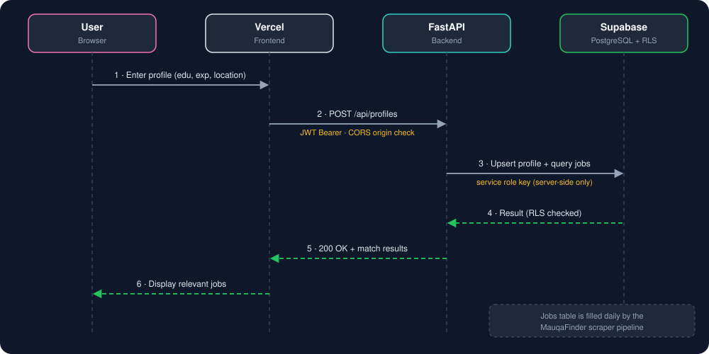

# 🚀 MauqaFinder App: Job Matching SaaS Engine


The **MauqaFinder App** is a full-stack SaaS platform that matches candidates with government job opportunities based on their exact qualifications. It consumes the dataset produced by the [MauqaFinder Scraper Pipeline](https://github.com/hasaan1315/MauqaFinder).

---

## 📑 Table of Contents

- [System Architecture](#️-system-architecture)
- [Key Features](#-key-features)
- [Tech Stack](#-tech-stack)
- [Security & Database Engineering](#-security--database-engineering)
- [API Documentation](#-api-documentation)
- [Setup & Installation](#-setup--installation)
- [Database Policy Deployment](#-database-policy-deployment)
- [Deployment](#-deployment)
- [Roadmap](#-roadmap)

---

## 🏗️ System Architecture



**Data supply:** the scraper repo upserts fresh job postings into Supabase every day. This app reads that data, applies the candidate's profile, and returns the best matches.

---

## ✨ Key Features

- **Profile-based matching:** candidates enter education, experience, and location, then get relevant government jobs.
- **Always fresh data:** jobs come from an automated daily ETL pipeline.
- **Secure by default:** every profile row is protected by database-level policies.
- **Auto-generated API docs:** interactive Swagger and ReDoc from FastAPI.

---

## 🧰 Tech Stack

| Layer | Tools |
|---|---|
| Backend | FastAPI, Uvicorn, Python 3.9+ |
| Database & Auth | Supabase (PostgreSQL, JWT auth, RLS) |
| Frontend hosting | Vercel |
| Data source | [MauqaFinder scraper](https://github.com/hasaan1315/MauqaFinder) |

---

## 🔐 Security & Database Engineering

| Control | How it works |
|---|---|
| **Row-Level Security (RLS)** | Policies enforce access at the database layer. Authenticated users can only `SELECT`, `INSERT`, or `UPDATE` rows where `auth.uid() = id`. |
| **CORS hardening** | `CORSMiddleware` accepts traffic only from the Vercel production origin. Other origins are blocked. |
| **JWT verification** | The frontend sends a Bearer token with each request to the API. |
| **Service role usage** | The Supabase `service_role` key is used only inside backend endpoints that need system-level upserts. |

> ⚠️ **Never expose the `service_role` key** in frontend code, public repos, or browser requests. It bypasses RLS. Keep it only in backend environment variables. The frontend must use the `anon` key.

---

## 🔌 API Documentation

FastAPI generates interactive OpenAPI docs automatically. With the server running locally:

| Tool | URL |
|---|---|
| Swagger UI | http://localhost:8000/docs |
| ReDoc | http://localhost:8000/redoc |

---

## 🚀 Setup & Installation

### Backend (FastAPI)

**1. Clone and create a virtual environment**

```bash
git clone https://github.com/hasaan1315/MauqaFinder-app.git
cd MauqaFinder-app/backend
python -m venv venv
source venv/bin/activate      # Windows: venv\Scripts\activate
pip install -r requirements.txt
```

**2. Configure environment variables**

Create a `.env` file in the backend directory (never commit it):

```env
SUPABASE_URL=https://your-project-ref.supabase.co
SUPABASE_KEY=your_service_role_key
```

**3. Run the server**

```bash
uvicorn app.main:app --reload
```

The API runs at `http://localhost:8000`.

---

## 🗄️ Database Policy Deployment

Run the following in the Supabase **SQL Editor** to enable RLS and apply the security policies:

```sql
-- Enable RLS
ALTER TABLE public.user_profiles ENABLE ROW LEVEL SECURITY;

-- Apply security policies
CREATE POLICY "Allow users to view own profile"
  ON public.user_profiles FOR SELECT
  USING (auth.uid() = id);

CREATE POLICY "Allow users to update own profile"
  ON public.user_profiles FOR UPDATE
  USING (auth.uid() = id);

CREATE POLICY "Allow insert for authenticated users"
  ON public.user_profiles FOR INSERT
  TO authenticated
  WITH CHECK (auth.uid() = id);
```

---

## 🌐 Deployment

| Part | Platform | Notes |
|---|---|---|
| Frontend | Vercel | Set the public API URL and Supabase `anon` key as environment variables. |
| Backend | Your chosen host | Set `SUPABASE_URL` and `SUPABASE_KEY` as secrets. Update the CORS allowed origin to the Vercel production URL. |

---

## 🗺️ Roadmap

- [ ] Match score and ranking explanation per job
- [ ] Email or Telegram alerts for new matching jobs
- [ ] Saved jobs and application tracker
- [ ] Rate limiting on API endpoints

---

## 🤝 Related

- 🕵️‍♂️ **Scraper pipeline:** [MauqaFinder](https://github.com/hasaan1315/MauqaFinder)

## 👤 Author

**Hasaan** — Data Engineer · [GitHub](https://github.com/hasaan1315)
